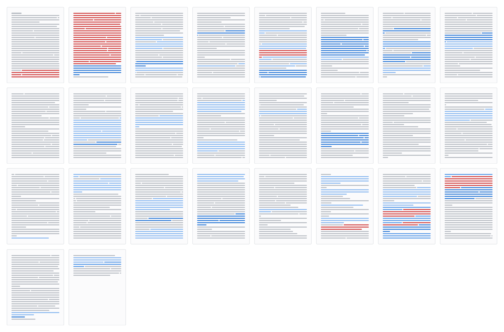

# How much of a 10-K risk section is boilerplate?

Every public company lists the risks it faces in its annual report. This project compares 47,643 of those sections with the same company's section from the year before, sentence by sentence (14.3 million sentences, 10,779 companies, fiscal 2007 to 2020), to measure how much is carried over, to check how far that measurement can be trusted, and to test what makes companies rewrite.

**[Read the report](https://jlattanzi4.github.io/sec-risk-classifier/report.html)**

[](https://jlattanzi4.github.io/sec-risk-classifier/report.html)

*One real risk section (Kellogg Co, fiscal 2019) marked up against the year before, a line a sentence. Gray is kept word for word, blue is edited, reworded or new, red was cut. The filing was chosen by rule: the one closest to the median filing.*

## What it found

- **73.4% of sentences are last year's, word for word**, and another 11.6% are light edits. In the median section, 8.4% of the sentences are new.
- **Boilerplate travels between companies.** 7.3% of full sentences are filed word for word, in the same year, by at least 5 other companies. That share rose from 2.2% to 13.7% over the period.
- **A new sentence has a 23% chance of being gone the next year**, and the risk falls every year it survives. Sentences shared with other companies last a median of 10 filings, against 5 for a company's own.
- **Rewriting is an event, not a trait.** 84% of the variation in how much of a filing is new is the same company differing from itself from one year to the next.
- **The pandemic made companies add, not rewrite.** Companies that filed their fiscal 2019 report after the pandemic was declared added sentences about COVID worth 1.3% of the section. The change in their new text overall can't be told from zero (+0.8 points, 95% interval −0.6 to +2.3). The larger change came a year later, with the SEC's new risk-factor rules: reports filed before them cut 6.0% of the previous year's sentences, and reports filed after cut 11.6%.

## How far to trust it

No person labeled anything. The measurement was checked three ways, and the report shows what failed as well as what held.

- **Two language-model judges** labeled 2,000 pairs of real sentences. They agreed only moderately (a kappa of 0.60, under the 0.70 set as the bar in advance), so the check uses the 307 pairs both agree on. On those, an "edited" match is right 94.8% of the time and a "new" call 99.6%. "Reworded" is the weakest label: 80.1%, on 34 pairs.
- **A threshold that failed.** The cut-off for "reworded", tuned on constructed pairs, was wrong on 69% of the real pairs it accepted. It was tuned again on real pairs, and the report says so.
- **It follows words, not meaning.** Of 300 test sentences whose claim was reversed by changing a word or two, 292 count as carried over. Such edits turn out to be rare in real filings, and this is reported as the method's limit.
- **Against nothing.** Matched against an unrelated company's filing in place of its own, 0.6% of a section's sentences come out kept or edited. Against its own, 82.7%.

## How it is built

One pipeline, one stage per step, each caching its output so a rerun resumes where it stopped. Every number in the report comes from one committed file, `docs/data/report.json`, and each stage has a write-up with the command behind every figure.

| Step | What it does | Write-up |
|---|---|---|
| Data | Filing dates and industries from SEC EDGAR, and a sentence table for every section | [`docs/data-foundation.md`](docs/data-foundation.md) |
| Measure | Exact, near and reworded matching between consecutive filings; a known-answer test set; two-judge validation; baselines | [`docs/measurement.md`](docs/measurement.md) |
| Explain | Survival of added sentences, a hazard model with a company random effect, and a variance decomposition, fit by NUTS | [`docs/explain.md`](docs/explain.md) |
| Test | A difference-in-differences around the start of the pandemic, with placebo years and an event study | [`docs/test-2020.md`](docs/test-2020.md) |
| Publish | The report's data file and the page | `pipeline/report_json.py`, `src/generate_report.py` |

## Reproduce

Python 3.12 with [uv](https://docs.astral.sh/uv/).

```bash
uv sync
uv run pytest -q
uv run python -m pipeline.run all        # every stage, in order
uv run python src/generate_report.py     # docs/report.html and this README's numbers
```

The data are not in the repository. The sections come from [EDGAR-CORPUS](https://huggingface.co/datasets/eloukas/edgar-corpus); filing dates and industries are downloaded from SEC EDGAR, which asks for a contact in each request, so set `SEC_USER_AGENT` in a `.env` file first. A full run takes a few hours on an M3 laptop, about two hours of it embedding sentences. The language-model stages reuse the replies saved under `validation/` and call nothing unless one is missing.

## What the first version got wrong

This is the second version. A review in November 2026 retracted the first version's two headline claims: a "51% semantic against 21% lexical" similarity gap that compared scores computed on different amounts of text, and a 71.2% F1 from an evaluation in which copies of test rows were in the training set. The first version is kept under the [`v1-original`](https://github.com/jlattanzi4/sec-risk-classifier/tree/v1-original) tag, and the review is in issues [#2](https://github.com/jlattanzi4/sec-risk-classifier/issues/2) and [#1](https://github.com/jlattanzi4/sec-risk-classifier/issues/1).

## License

MIT. See [LICENSE](LICENSE).

## Author

**Joseph Lattanzi**, data scientist: [portfolio](https://jlattanzi4.github.io/), [GitHub](https://github.com/jlattanzi4), [LinkedIn](https://www.linkedin.com/in/jlattanzi4/).
